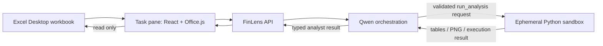
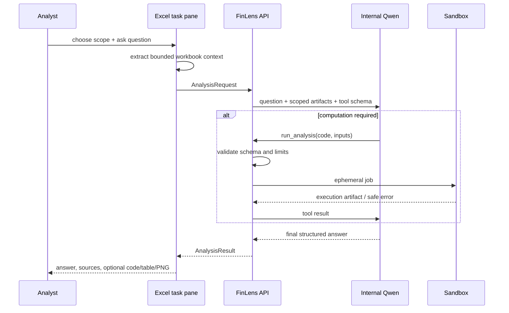

# Architecture Spine — FinLens MVP

## Design Paradigm

**Hexagonal backend with a thin Office.js adapter and isolated analysis jobs.**

- `add-in` is the only adapter allowed to call Office.js and read workbook state.
- `api` owns sessions, validation, orchestration, result contracts and lifecycle cleanup.
- `qwen-adapter` is the only port to the internal LLM endpoint.
- `sandbox-runner` is the only port allowed to execute generated Python.
- `ui` renders typed API results; it never interprets or executes LLM code.



## Invariants & Rules

### AD-1 — Workbook access is client-side and functionally read-only [ADOPTED]

- **Binds:** `add-in`, `excel-context`, all tests
- **Prevents:** backend or sandbox gaining Office access; accidental mutations from UI code.
- **Rule:** Only the Office.js context extractor may read Excel. No code path may call a write Office.js API. The sandbox receives copied tabular artifacts only. Each analysis integration test must prove the workbook is unchanged.

### AD-2 — Every analysis has an explicit, bounded data scope [ADOPTED]

- **Binds:** `excel-context`, `api`, `agent`, `sandbox`
- **Prevents:** shipping an unbounded workbook or irrelevant data to Qwen/sandbox.
- **Rule:** A request declares `range`, `sheet`, or `workbook`. `workbook` first produces a map, then the API selects bounded relevant artifacts. Results name the actual sheets and ranges used.

### AD-3 — The API owns all untrusted-boundary validation

- **Binds:** `api`, `qwen-adapter`, `sandbox-runner`
- **Prevents:** raw UI input, raw LLM output or generated code becoming executable authority.
- **Rule:** The API validates client payloads, Qwen tool-call JSON, artifact size and result schema. Qwen may request only `run_analysis`; it cannot select a command, network address, filesystem path or credential.

### AD-4 — Python execution is an ephemeral, deny-by-default job [ADOPTED]

- **Binds:** `sandbox-runner`, deployment, security tests
- **Prevents:** generated code reading secrets, using the network, persisting data or changing the host.
- **Rule:** Every execution runs non-root with a read-only root filesystem, no host mounts, no credentials, no network, dropped capabilities and a small writable output directory. Only allowlisted packages and explicit CPU, memory, wall-time and output-size limits are available. The job and artifacts are deleted on completion, cancellation or timeout.

### AD-5 — Execution truth precedes narrative

- **Binds:** `agent`, result contract, UI
- **Prevents:** a financial conclusion or code block that does not match the computation.
- **Rule:** The final answer may cite computed values or show a code block only from a successful execution artifact. On failure, Qwen receives the bounded error and may make at most two correction attempts; after that the typed result is an honest failure, not a guessed answer.

### AD-6 — A session is in-memory and disposable [ADOPTED]

- **Binds:** `api`, `agent`, `sandbox-runner`, observability
- **Prevents:** persistent chat history or workbook data contrary to product scope.
- **Rule:** Chat turns, workbook maps, scoped artifacts, code and PNGs belong to one session and are cleared on cancellation, task-pane unload or server TTL. Logs retain only operational metadata unless a separate policy explicitly approves more.

### AD-7 — No end-user authentication and no client secrets [ADOPTED]

- **Binds:** `add-in`, `api`, deployment
- **Prevents:** a login UX or internal LLM credentials leaking into the add-in.
- **Rule:** The task pane makes anonymous requests to the internal FinLens API. The deployment restricts reachability to the corporate network. Any credential required for the internal Qwen service is server-held only.

### AD-8 — Compatibility is checked at runtime [ADOPTED]

- **Binds:** manifest, `add-in`, UX error state
- **Prevents:** unsupported Excel clients failing silently.
- **Rule:** The add-in targets Excel Desktop on Windows, declares the minimum requirement set needed by implemented APIs, and checks required Office.js APIs at runtime before enabling analysis. Preview APIs are prohibited in MVP.

## Consistency Conventions

| Concern | Convention |
| --- | --- |
| IDs and correlation | Every request, sandbox job and result uses the same opaque `analysisId`; never use workbook names or cell contents as IDs. |
| Data artifact | `WorkbookMap` contains metadata only; `TabularArtifact` contains bounded values, formulas, number formats, sheet name and A1 address. |
| API result | A typed `AnalysisResult` is either `completed`, `cancelled` or `failed`; `completed` contains narrative, sources and optional computation artifacts. |
| Errors | API exposes stable `code`, human-readable `message` and `nextAction`; raw traceback stays server-side except a safe diagnostic excerpt in the code block. |
| State mutation | Add-in mutates only local UI state. API may create and dispose session-scoped state. Sandbox cannot mutate data outside its own ephemeral job. |
| Logging | Log metadata: `analysisId`, timings, artifact sizes, tool outcome and error code. Never log raw workbook cells, prompts, code or PNG by default. |
| Naming | TypeScript uses `camelCase`; Python uses `snake_case`; API JSON uses `camelCase`; domain nouns are `AnalysisRequest`, `WorkbookMap`, `TabularArtifact`, `AnalysisResult`. |

## Stack

| Name | Version |
| --- | --- |
| Task pane | React 19.2.1 + TypeScript 7.0 |
| Excel integration | Office.js production CDN `/1/`; ExcelApi minimum set chosen after extractor implementation |
| API | Python 3.13 + FastAPI 0.142.3 |
| LLM integration | Internal Qwen endpoint using OpenAI-compatible tool-calling contract |
| Code isolation | Docker Engine with hardened ephemeral containers |

## Structural Seed

```text
finlens/
  add-in/                 # React task pane, manifest, Office.js context adapter
  api/
    app/
      domain/             # typed request, artifact and result contracts
      application/        # analysis use case and session lifecycle
      adapters/           # Qwen client, sandbox runner, ephemeral store
      api/                # HTTP and streaming endpoints
  sandbox-image/          # fixed Python image and allowlisted dependencies
  tests/
    fixtures/             # de-identified Excel workbooks and expected facts
    integration/          # workbook immutability, agent and sandbox contracts
```



## Capability → Architecture Map

| Capability / Area | Lives in | Governed by |
| --- | --- | --- |
| Choose range, sheet or workbook | `add-in/excel-context` | AD-1, AD-2, AD-8 |
| Map a large workbook | `api/application` | AD-2, AD-6 |
| Detailed analyst answer | `api/application` + `qwen-adapter` | AD-3, AD-5, AD-6 |
| Python calculations and PNG | `sandbox-runner` + `sandbox-image` | AD-3, AD-4, AD-5 |
| Visible sources, code and results | `add-in/ui` | AD-2, AD-5 |
| No retained history | `api/application` + deployment cleanup | AD-6 |
| No user login | `add-in` + internal deployment | AD-7 |

## Deferred

- Exact ExcelApi minimum requirement set — choose after the extractor API surface is implemented; runtime compatibility rule is already binding.
- Internal API network placement, rate limits and backend service identity — depend on the company infrastructure owner; must be set before deployment.
- Exact sandbox resource limits and TTL — tune against representative de-identified workbooks during implementation and pilot.
- Design-system tokens and final visual styling — UX spines carry assumptions until user review; architecture is unaffected.
- External market-data integrations, saved history, editing workbook data and report export — excluded from MVP and require new architecture decisions.
